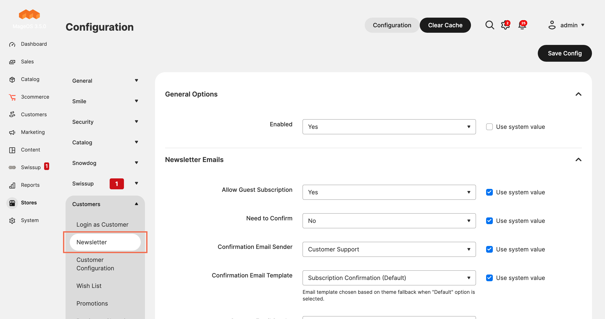

# Threecommerce_DisableNewsletterEmail: turn off Magento 2 newsletter transactional emails

Selectively disable the transactional emails Magento sends for newsletter subscriptions, without disabling the subscription feature itself.



**Compatibility:** Magento Open Source / Adobe Commerce 2.4.4 – 2.4.9 · Mage-OS 1.x / 3.x · PHP 8.1 – 8.4 · Themes: Luma, Hyvä, Breeze
**License:** free · **Current version:** see [Releases](../../releases)

## Features

- Independent switches for the **Confirmation Request** email (double opt-in request), the **Confirmation Success** email and the **Unsubscribe** email.
- The subscription state still changes normally: only the email is skipped.
- How it works: a plugin on `Magento\Newsletter\Model\Subscriber` checks the matching store configuration flag before each email-sending method. When the flag is **No**, the subscriber is switched to *import mode*, which makes Magento skip that email.

## Requirements

- Magento Open Source / Adobe Commerce 2.4.4+ or Mage-OS
- PHP 8.1 – 8.4
- Native module: `Magento_Newsletter`
- Package: `threecommerce/m2-base` (installed automatically by Composer)

## Installation

The package is distributed through our Composer repository at `repo.threecommerce.it`. Request the credentials from the [product page](https://www.threecommerce.it/disattiva-email-newsletter-magento-2?utm_source=github&utm_medium=readme&utm_campaign=magento2-disable-newsletter-emails), then:

```bash
composer config repositories.threecommerce composer https://repo.threecommerce.it
composer require threecommerce/m2-disable-newsletter-notify
bin/magento module:enable Threecommerce_DisableNewsletterEmail
bin/magento setup:upgrade
bin/magento cache:flush
```

## Configuration

Admin → **Stores → Configuration → Customers → Newsletter → Newsletter Emails**: choose Yes or No for each of the three emails.

## Documentation and support

- Product page: [threecommerce.it/disattiva-email-newsletter-magento-2](https://www.threecommerce.it/disattiva-email-newsletter-magento-2?utm_source=github&utm_medium=readme&utm_campaign=magento2-disable-newsletter-emails)
- [Changelog](CHANGELOG.md) (in Italian)
- Support and custom development: [threecommerce.it/contatti](https://www.threecommerce.it/contatti?utm_source=github&utm_medium=readme&utm_campaign=magento2-disable-newsletter-emails)

---

*This repository is the public showcase of the module. The source code is kept in a private repository.*
